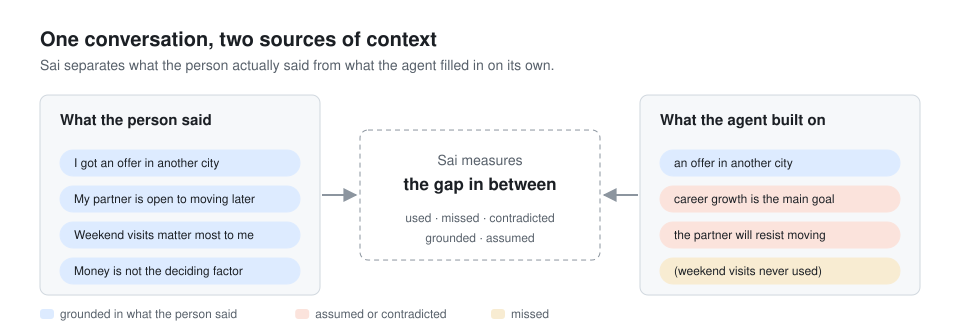
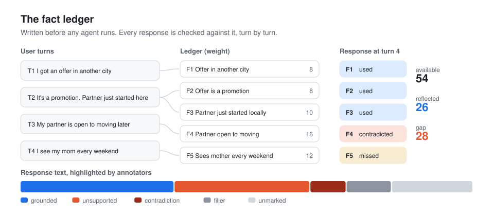

# Sai (사이)

Behavioral observability for agents that talk to people.

Sai measures what an agent actually takes from the person it is talking to, what it fills in on its own, and whether it keeps up as the person tells it more.



## Vision

Agents that keep track of the actual person in front of them. When someone explains their situation, the response they get should reflect what they said, change as they say more, and stay open about what it does not yet know.

## Mission

Make agent assumptions visible and correctable, so people keep their agency in conversations with AI.

Sai separates what a user said from what an agent assumed, follows that separation turn by turn, and turns the result into something a product team can test, monitor, and fix as models change.

## Demo

[](https://youtu.be/ZK8YWPX-pMc)

*The multi-turn trajectory prototype. Click to watch on YouTube.*

## Why this matters

Agents often act before they know enough. A reply can read as fluent and caring while resting on facts the user never gave. Across a longer conversation the user keeps adding context, yet the agent can stay locked into its first reading of the situation. Each reply looks reasonable when scored on its own. The failure only shows up when you look at the whole trajectory.

For people, this means advice built on someone else's assumptions. For teams that deploy agents, it means behavior they cannot see, cannot specify, and cannot catch when a model update changes it.

## How Sai works

### 1. Separate fact from assumption

Every piece of context the user gives becomes an entry in a fact ledger, written before any agent runs. Each response is checked against that ledger. Did it use the fact, miss it, or contradict it? Annotators also mark which parts of a response are grounded in the user's words and which treat an unstated assumption as a premise.



The [Behavior Lab](behavior-lab/) is where this coding happens. The demo here charts how much of each response rests on the user's words and how much rests on the agent's own assumptions.


### 2. Follow behavior across turns

A scripted conversation reveals information step by step. The ledger defines how much context the agent has been given at each turn. Annotation shows how much of it the response reflects. The distance between those two lines is the **context adaptation gap**.


*Synthetic example. Agent A misses one fact, then picks it up on its own. Agent B contradicts what the user said, needs corrections to catch up, and ends with context it never used.*

The shape of the gap over time tells you what kind of failure you are looking at. See [docs/trajectory.md](docs/trajectory.md).


### 3. Calibrate with people first

People code a first set of responses. Two independent LLM judges score the same set. Disagreements go to an adjudication queue, and a judge only takes over once it agrees with people closely enough. This is how the measurement scales without drifting away from the people who coded it.


## What is in this repository

| Path | What it is |
| --- | --- |
| [`docs/framework.md`](docs/framework.md) | The fact and assumption distinction and the behavioral axes, at a conceptual level |
| [`docs/trajectory.md`](docs/trajectory.md) | How the multi-turn trajectory eval works and the failure patterns it looks for |
| [`docs/research.md`](docs/research.md) | The research line Sai grows out of, from Kairos to multi-turn context adaptation |
| [`behavior-lab/`](behavior-lab/) | Runnable demo of fact vs. assumption shares, rater agreement, and the adjudication queue |
| [`trajectory/`](trajectory/) | Runnable demo that computes the context adaptation gap and draws the trajectory chart |

Both demos use the Python standard library and synthetic data.

```bash
python behavior-lab/agreement.py --svg assets/behavior_lab_shares.svg
python trajectory/trajectory.py --svg assets/trajectory_example.svg
```

## What is not here, by design

Sai is active research and an early venture. This repository shares the ideas and the structure of the measurement. It does not include the scoring anchors, the calibrated judge prompts, the scenarios and turn scripts used in studies, the collected model responses, or the annotation data. The full Behavior Lab and trajectory tools run privately.

## Research line


- **Kairos** ([HongbeePark/kairos](https://github.com/HongbeePark/kairos)). The earlier framework for socially situated appropriateness in AI advice, built on human expectation ranges.
- **From Context Recognition to Context Uptake in LLM Advice Behavior** (workshop paper, under review at NeurIPS 2026 IAB). Shows that models can name missing context and still give the same advice.

More in [docs/research.md](docs/research.md).

## Author

Hongbee Park. Harvard MDE 2026, Berkman Klein Center affiliate. Previously Lead PM at Toss and Researcher at Scale AI.

## License

CC BY-NC-ND 4.0. You may read and cite this work with attribution. Commercial use and derivative works are not permitted. See [LICENSE](LICENSE).
