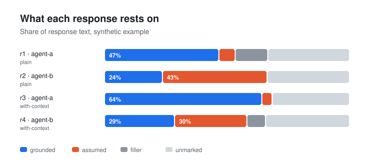
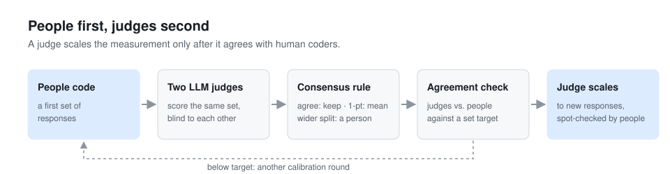

# Behavior Lab demo

The Behavior Lab is Sai's annotation workspace. People and LLM judges code agent responses against the user's actual words, compare their codes, and resolve disagreements before any judge runs on its own. The full tool (response collection, span highlighting, rubric versioning, agreement heatmap, adjudication queue, cross-model comparison) runs privately. This folder contains a small runnable demo of the two ideas at its center.

## Run

```bash
python agreement.py
python agreement.py --svg ../assets/behavior_lab_shares.svg
```

## What it shows

**Fact vs. assumption share.** Each response is highlighted as grounded, unsupported, contradiction, or filler. The demo reports how much of each response rests on what the user said and how much rests on what the agent assumed.



**Agreement before automation.** Two human annotators and two LLM judges score the same responses on four behavioral axes. The demo prints exact agreement, within-one agreement, and mean absolute error for every pair of raters. It then applies the judge consensus rule (agree keeps the value, a one-point split takes the mean, a wider split goes to a person) and lists what a person needs to adjudicate.



## Data

`example_annotations.json` is synthetic. Responses, codes, and annotator names are invented to show the format. No study data, model output, or scoring anchors are included.
