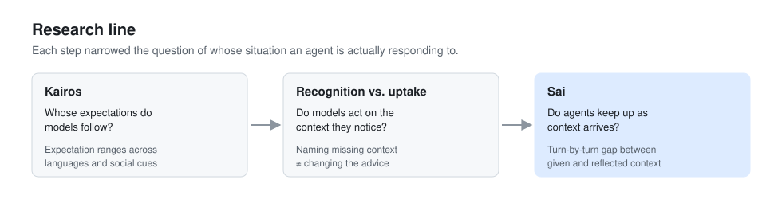

# Research line

Sai grows out of one question that kept coming back in different forms. When an agent gives someone advice, whose situation is it actually responding to?

## 1. Kairos: whose expectations?

[Kairos](https://github.com/HongbeePark/kairos) tested advice scenarios across models, languages, and social cues against ranges of human expectation, instead of a single correct answer. Responses looked fluent and polite on the surface, while the underlying behavioral defaults stayed much the same across contexts. Differences between individuals turned out to matter more than group labels. That moved the focus from culture as a category to the specific context each person brings.

## 2. Recognition is not uptake

The next step asked whether models notice the context they are missing and whether noticing changes anything. Models were run plainly, with a step that asked them to separate known from unknown information, and with context supplied by researchers. Models could often list what they did not know and then return to the same advice. Recognizing context and acting on it are different capabilities, and evaluation needs to measure them separately.

This work is written up in *From Context Recognition to Context Uptake in LLM Advice Behavior* (workshop paper, under review at NeurIPS 2026 IAB).

## 3. Context adaptation over turns

Real conversations do not hand over all the context at once. People reveal what matters gradually, and often only after the agent has already formed a view. Sai's current work follows that process turn by turn, measuring the gap between the context a user has given and the context a response reflects, and the failure patterns that open and close it. See [trajectory.md](trajectory.md).

## Where this is going

- A public benchmark for multi-turn context adaptation, focused on the one thing it measures, that others can run on their own agents and products.
- Moving from scripted scenarios toward real conversations, where observed failures feed back into the evaluation axes.
- A behavioral spec layer for teams deploying agents in conversation-heavy products. Write down how the agent should treat users, test it, and keep it true as models change.
