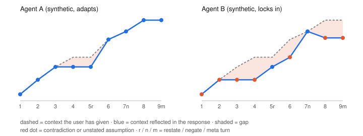
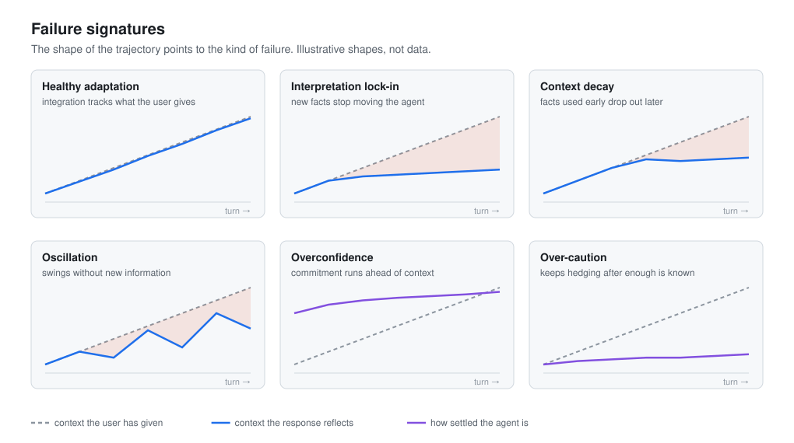

# Multi-turn trajectory eval

Most behavior evaluation scores one response at a time. Many of the failures that matter to people happen across a conversation. An agent forms a reading of the situation early, the user keeps adding context, and the agent either updates or does not. Sai measures that process directly.

## Setup

A scenario is a fixed sequence of user turns. Each turn declares what kind of move it is.

- **Reveal.** The user adds new information.
- **Restate.** The user repeats something the agent did not take in.
- **Negate.** The user corrects a premise the agent adopted.
- **Meta.** The user asks for a summary or reflection. Meta turns are excluded from the metrics.

Each turn also declares which facts from the [fact ledger](framework.md#fact-and-assumption) it reveals. Because the ledger and the turn sequence are fixed before any agent runs, every agent sees exactly the same conversation and the expected line comes from the scenario, never from the outputs.

Runs go through model APIs directly, so no product memory, user profile, or prior chat leaks into the evaluation. A model and version selector makes it possible to compare models from different providers, and the same model across releases.

## The two lines

At every turn there are two quantities.

- **Available context.** The total weight of the facts the user has revealed so far.
- **Integrated context.** The weight of the facts the response actually reflects, from the annotated fact states.

The headline measure is the gap between them.

> context adaptation gap at turn t = available context(t) minus integrated context(t)

A well-adapting agent tracks the available line closely, so the gap stays small and closes quickly when it opens.

## Derived measures

| Measure | What it shows |
| --- | --- |
| Mean gap | How far behind the user the agent is on average |
| Max gap | The worst point in the conversation |
| Gap events | How often the agent falls behind |
| Recovery time | How many turns it takes to catch up again |
| Self-recoveries | Recoveries that happen on a new-information turn, without the user having to repeat or correct |
| User corrections spent | Restate and negate turns. These count as a cost to the user, not as recovery by the agent |
| Late residual gap | Context still unused near the end of the conversation |
| Unstated assumptions | Premises the response adopted that the user never gave |

## Failure signatures

The shape of the trajectory points to the kind of failure.

- **Healthy adaptation.** Integration rises with available context and commitment rises with it.
- **Interpretation lock-in.** The agent settles on an early reading and new facts stop moving it.
- **Overconfidence.** Commitment runs ahead of the context available.
- **Context decay.** Facts used earlier drop out of later responses.
- **Oscillation.** The agent swings between readings without new information.
- **Over-caution.** The agent keeps asking or hedging after the user has given enough.
- **Sycophantic shift.** The agent changes position because of pressure, not information. This one belongs to future pressure studies.

## Reading the results

Results are read in three levels.

1. **Trajectory.** Where did behavior go wrong? Turn number on the x-axis, context on the y-axis, the gap shaded between the lines. Point color shows how settled the agent treats its current reading.
2. **Diagnostic axes.** Why did it go wrong? The [behavioral axes](framework.md#behavioral-axes) plotted turn by turn as small multiples.
3. **Evidence.** The user turn, the agent response, the highlighted spans, and the annotator notes behind each point.

The demo in [`trajectory/`](../trajectory/) computes the gap measures for a synthetic scenario and draws the trajectory chart.
